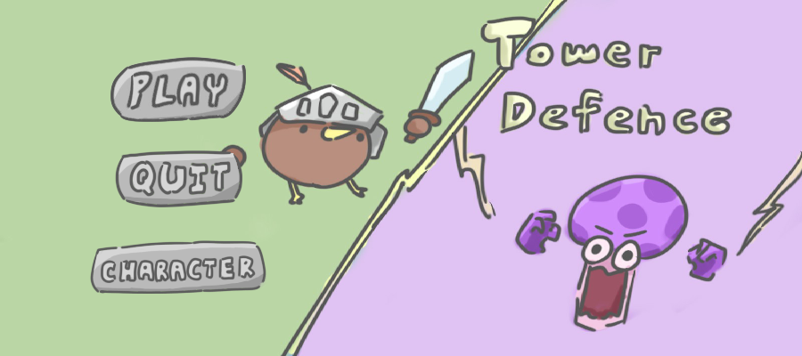
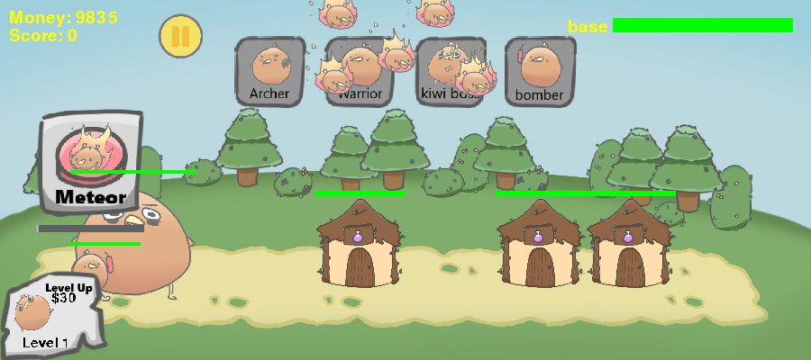

# Pygame 塔防遊戲

以 Python 與 Pygame 製作的 2D 塔防遊戲。玩家透過滑鼠召喚單位、管理金錢並升級收入，阻止敵人抵達基地。此名稱為整理時暫定名稱。



## 下載 Windows EXE

不需要安裝 Python 或 Pygame。圖片、字型與音樂皆內含於 EXE。

- [下載 Windows 64 位元 EXE](https://github.com/Sloth0528/pygame-tower-defense/releases/download/v1.0.0/ActualPygame.exe)
- [下載 EXE 壓縮包與使用說明](https://github.com/Sloth0528/pygame-tower-defense/releases/download/v1.0.0/ActualPygame-Windows.zip)
- [查看 v1.0.0 發行說明](https://github.com/Sloth0528/pygame-tower-defense/releases/tag/v1.0.0)

下載 EXE 後雙擊執行；若使用壓縮包，先完整解壓縮。首次啟動需短暫解壓內附資源。
此檔案適用於 Windows 64 位元；其他系統請使用原始碼並自行確認相容性。



## 功能

- 開始畫面、關卡選單、角色圖鑑與製作名單。
- 五種關卡的敵人生成規則。
- 近戰、遠程、大型及爆炸鳥單位召喚；角色動畫、投射物與碰撞傷害。
- 隕石技能與背景音樂。
- 基地生命、擊殺得分、金錢及收入升級。
- 暫停、繼續及返回選單。

## 執行（Windows PowerShell）

建議使用 Python 3.12；本次檢查使用 Python 3.12.10 與 Pygame 2.6.1。
請先在本專案資料夾開啟 PowerShell：

```powershell
py -3.12 -m venv .venv
.\.venv\Scripts\python.exe -m pip install -r requirements.txt
.\.venv\Scripts\python.exe main.py
```

也可以在安裝依賴後雙擊 `start.bat`。不需要啟用虛擬環境。
若 `py -3.12` 找不到 Python，需先安裝 Python 3.12。

## 操作

1. 在開始畫面按 Play，選擇關卡。
2. 等待金錢增加，再點擊角色按鈕召喚單位。
3. 近戰、遠程、大型與爆炸鳥單位分別需要 10、15、40、100 金錢。
4. 使用升級按鈕提高收入；使用暫停按鈕暫停或返回。
5. 基地生命歸零時顯示失敗及得分。

## 程式結構

| 檔案／資料夾 | 用途 |
|---|---|
| `main.py` | 入口、畫面狀態切換與主迴圈 |
| `asset_loader.py` | 依程式所在位置定位圖片與字型，不受啟動位置影響 |
| `gameplay.py` | 單位、敵人、戰鬥、收入與關卡邏輯 |
| `button.py` | 共用互動按鈕 |
| `starting_menu.py`、`main_menu.py` | 開始畫面與關卡選單 |
| `characters_menu.py`、`credits.py` | 角色圖鑑與製作名單 |
| `g_var.py` | 金錢、分數與暫停等共用狀態 |
| `assets/`、`UI/` | 背景、字型與介面素材 |
| `birdani/`、`mushrooms/`、`misks/` | 角色動畫、敵人及場景素材 |
| `audio/` | 背景音樂素材 |
| `launch.py`、`ActualPygame.spec` | EXE 入口與可搬移的打包設定 |
| `asset-manifest.json`、`packaged_checks.py` | 素材雜湊清單與 EXE 資源檢查 |
| `BUILD.md` | 重建 EXE 與驗證範圍說明 |

## 作者與分工

原始 `credits.py` 列出製作者：黃紹洋、鄭佑明、郭峻愷、葉丙祥；美術：郭峻愷；並感謝 Angus beef 協助插畫。
本整理版保留上述原始署名。

**我的負責部分：初始程式碼產出與玩法設計。**

## 展示與素材

原始展示錄影另行保存，未放進程式碼包。上傳 GitHub 後可在 Issue 留言編輯器附上影片，再把產生的連結加入此處；若超過附件限制，可使用影片平台連結。
圖片、字型與音樂的來源及授權尚待補充；本整理版未替原始作品與素材指定開源授權。公開展示前應確認共同作者與素材的公開使用條件。

## 已知限制

- 圖片與字型透過 `asset_loader.py` 定位，可從其他工作目錄啟動 `main.py`。下載時仍需保留完整素材資料夾。
- 目前沒有遊戲進度存檔功能。
- 尚未宣稱完成所有關卡的完整遊玩驗證。

## EXE 驗證

已在另一個含中文及空格的資料夾單獨啟動 EXE，PATH 不含 Python，並核對 130 個素材的雜湊值：128 張圖片、1 個字型與 1 個音樂均可載入。
四個選單與五個關卡的初始單位、隕石及敵人召喚檢查通過。測試採 SDL dummy 驅動並檢查產生的畫面，未涵蓋完整通關或所有 Windows 硬體。

[檢查結果](docs/exe-verification.json) · [重建 EXE](BUILD.md) · [原始下載版介紹](docs/ORIGINAL_README.md)

整理過程與本次檢查結果見 [整理紀錄](docs/PREPARATION.md)。
